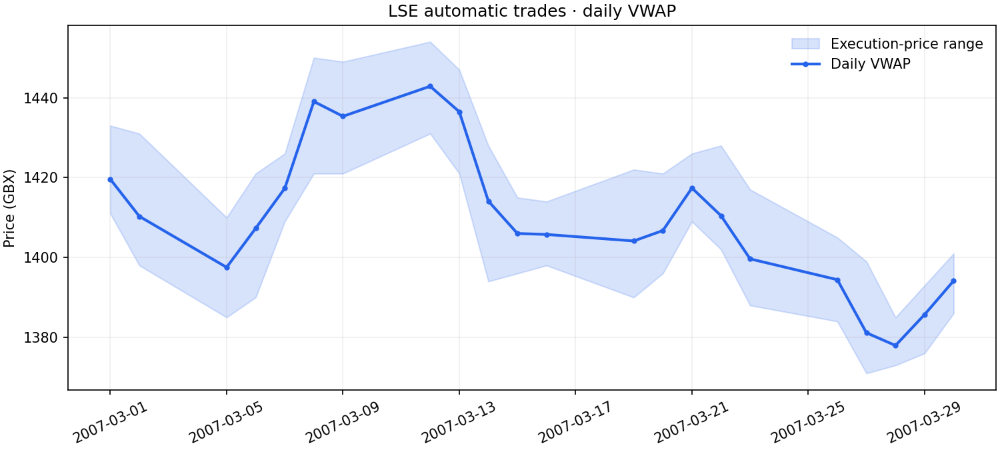

# LSE Market Data Analysis

A staged Python/SQL pipeline for historical London Stock Exchange orders and trades. Includes MySQL schemas, a portable SQLite runner, cancellation-aware reports, and a synthetic demo.

## Run the demo

```bash
python -m venv .venv
source .venv/bin/activate
python -m pip install --upgrade pip
python -m pip install -e '.[test]'
pytest -q
lse-data demo --db output/demo.sqlite --output output/demo
```

## Load local data

```bash
lse-data load --data-dir /path/to/csv-files \
  --db output/market.sqlite --output output/reports
lse-data report --db output/market.sqlite --output output/reports
```

Expected files: `allGlaxoOrderDetail.CSV`, `allGlaxoOrderHistory.CSV`, `allGlaxoTradeReport.CSV`. Each import requires an empty project database. Existing data is never overwritten; repeating an import fails before adding records.

MySQL setup and environment variables: [database guide](docs/database.md).

## Reports

- Daily automatic-trade VWAP, volume and price range.
- Cancellation messages, cancelled originals and unmatched cancellations.
- Trade types, order-side summaries and carry-over orders.
- Lifecycle action counts and optional execution-level exports (`--include-lifecycle`).
- Full individual order timelines through `lse_data.analysis.order_timeline(db, order_code)`.

## Verified dataset

726,666 records loaded with zero rejected rows and zero orphaned history rows. All 22 daily VWAP values match an independent Decimal calculation within 0.000001 GBX.

| Path | Purpose |
| --- | --- |
| `src/lse_data/cleaning.py` | Strict field normalization |
| `src/lse_data/ingest.py` | Transactional batch loading and raw staging |
| `src/lse_data/database.py` | SQLite/MySQL connection handling |
| `src/lse_data/sql/` | Both schemas and analytical SQL |
| `src/lse_data/analysis.py` | Reports, integrity audit and order timelines |
| `src/lse_data/demo.py` | Invented demo data |
| `scripts/verify_reference.py` | Independent validation against local CSV files |
| `tests/` | Unit and database integration tests |
| `results/` | Aggregate results and data hashes |



See [corrections](docs/corrections.md) and [validation](docs/validation.md). Vendor CSVs, database files, credentials and coursework attachments are excluded.
